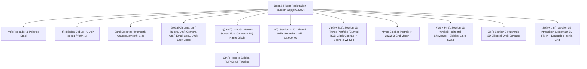

# Complete A-to-Z Reverse Engineering Report: `danielkiss.hu`


> [!IMPORTANT]
> **Full Site Cloned & Unminified in Workspace:**
> All 133 shipped assets (HTML, CSS, JS, 6 WOFF2 fonts, 120+ WebP images, and 4 MP4 videos) have been downloaded to [`c:/Users/PC/Desktop/web/ad`](file:///c:/Users/PC/Desktop/web/ad/index.html) and the bundle has been split and formatted into [`src-reverse/custom-app.js`](file:///c:/Users/PC/Desktop/web/ad/src-reverse/custom-app.js), [`src-reverse/vendor-gsap.js`](file:///c:/Users/PC/Desktop/web/ad/src-reverse/vendor-gsap.js), and [`src-reverse/styles.css`](file:///c:/Users/PC/Desktop/web/ad/src-reverse/styles.css).

---

## 1. REA Evidence Ledger & Provenance

| Evidence ID | Operation | Target / Scope | Confidence / Authority | Key Findings |
| :--- | :--- | :--- | :--- | :--- |
| `ev_54d3c57b4e0f2fa0302fdbc24f1e3101fd782c8f70df24c672e86c7be9c99851` | `capture_browser_scenario` | `https://danielkiss.hu/` (1440x900) | `observed` / `controlled-replay` | Initial DOM, accessibility tree, screenshot, and 42 initial network requests captured. |
| `ev_c5fd019e8e172a7e74caaba031c5e176ca88efe2e12b404ae269de9aa6515fe1` | `capture_browser_scenario` | Full body retention (`max_network_body_bytes: 10MB`) | `observed` / `controlled-replay` | Captured exact wire/API bytes for HTML (`61,467 B`), CSS (`57,233 B`), JS (`258,200 B`), fonts, WebP images, and MP4 streams. |
| `ev_7d8286e977d9a195cb65105ad6ec8f971d66040168800a084be729bbd4ff15ca` | `export_web_scripts` | `assets/main-dsDJGiab.js` (`sha256: 2e519f29...`) | `derived` / `historical-reference` | Exported digest-verified bundle (258,200 bytes) for static AST reconstruction. |
| `ev_30bdac0cad076fcc542e4b9129b55ed6ac6aa99bdcefc5d1b1f7e2a8ee59b5d0` | `analyze_javascript_application` | `main-dsDJGiab.js` (`jag_node_87500a0b...`) | `derived` / `shipped-artifact` | Static AST & module graph analysis (inspected via `ev_59f98839...`). No source maps shipped on origin (`404 Not Found`). |

---

## 2. Site Map, Pages & Tech Stack

### 2.1 Pages (`sitemap.xml`)
The site is a bilingual single-page portfolio with two static HTML entrypoints sharing the exact same CSS and JS bundle:
1. **English (Default):** [`index.html`](file:///c:/Users/PC/Desktop/web/ad/index.html) (`https://danielkiss.hu/`, `lang="en"`)
2. **Hungarian:** [`hu/index.html`](file:///c:/Users/PC/Desktop/web/ad/hu/index.html) (`https://danielkiss.hu/hu/`, `lang="hu"` — translates UI strings via [`ep`](file:///c:/Users/PC/Desktop/web/ad/src-reverse/custom-app.js#L1398-L1406) dictionary when `document.documentElement.lang === "hu"`).

### 2.2 Bundled Libraries & Build System
- **Bundler:** Vite (ESM output `/assets/main-dsDJGiab.js` + `/assets/main-Cqp_3XBK.css`, zero external CDN dependencies).
- **Animation Engine:** **GSAP 3.15.0** ([`vendor-gsap.js`](file:///c:/Users/PC/Desktop/web/ad/src-reverse/vendor-gsap.js)) with 5 registered plugins ([`custom-app.js#L4247`](file:///c:/Users/PC/Desktop/web/ad/src-reverse/custom-app.js#L4247)):
  1. `ScrollTrigger` (`Z`) — pinning, scrubbing, and viewport triggers.
  2. `ScrollSmoother` (`lc`) — smooth scrolling wrapper (`#smooth-wrapper` > `#smooth-content`, `smooth: 1.2`).
  3. `SplitText` (`Nc`) — splits headings/subheadings into `.char` and `.word` spans for per-character scatter/reveal.
  4. `Draggable` (`Pu`) — 2D x/y dragging for the `#contact` background tile wall.
  5. `InertiaPlugin` (`Ld`) + `VelocityTracker` (`Qu`) — momentum throwing on release in `#contact`.
- **WebGL & Canvas:** Custom vanilla **WebGL 1.0** Navier-Stokes fluid solver (no Three.js in bundle despite meta tags!) + custom **2D Canvas** barrel-warped RGB-glitch strip + trigonometrically projected 3D DOM orbit in `#awards`.

### 2.3 Design Tokens, Typography & Colors ([`styles.css#L1-L65`](file:///c:/Users/PC/Desktop/web/ad/src-reverse/styles.css#L1-L65))
- **Fluid Root Scaling:**
  - Desktop (`aspect-ratio >= 4/3`): `html { font-size: min(1.0596vw, 2.276vh); }`
  - Portrait/Mobile (`aspect-ratio < 4/3`): `html { font-size: min(1.359vw, 2.276vh); --sidebar-width: 0rem; --ui: clamp(12px, 3.2vw, 18px); }`
- **Color Palette (`:root`):**
  - `--color-bg`: `#17171a` (charcoal/almost-black background)
  - `--color-text` / `--color-accent`: `#ff321d` (vibrant vermilion/neon orange-red)
  - `--color-text-muted`: `#7a352c`
  - `--color-light`: `#ece7dc` (warm off-white bone/cream)
- **Fonts (`font/`):**
  - `--font-poster`: **`Anton`** (`Anton.woff2`, 400) — giant condensed uppercase display headings, counters, nav links.
  - `--font-body` / `--font-display` / `--font-secondary`: **`Satoshi`** (`Satoshi-Regular.woff2` 400, `Satoshi-Medium.woff2` 500, `Satoshi-Bold.woff2` 700, `Satoshi-Black.woff2` 900).
  - Handwritten / Graffiti Accent: **`Higher Jump`** (`higher-jump.regular.woff2`, 400) — used for annotations (`I MAKE THE WEB MISBEHAVE`, `KEEP DIGGING`, `WPKOI`, `Worth the try`, `Drag me`, `Scroll to top`, `Copied`).

---

## 3. Architecture Diagram



---

## 4. Section-by-Section & Animation Dissection (A to Z)

### A. Preloader ([`rh()`](file:///c:/Users/PC/Desktop/web/ad/src-reverse/custom-app.js#L4086-L4228), [`index.html#L97-L115`](file:///c:/Users/PC/Desktop/web/ad/index.html#L97-L115))
1. **Scroll Lock & Bailout:** Pauses `ScrollSmoother` at `scrollTop(0)`. Has a pure-CSS safety animation (`preloader-bailout 0.5s linear 9s forwards`) plus JS timeouts at `7.4s` and `8.5s` so the site never hangs if an asset fails.
2. **Ruler Construction:** Dynamically injects 101 `<span class="preloader-tick">` elements (`0%` to `100%`, major ticks every `10%`).
3. **Polaroid Stack (`.preloader-stage-cards`):** Injects the first 8 gallery images (`/img/gallery/1-300.webp` to `8-300.webp`) inside `.preloader-card` frames, initially scaled to `0.55` and rotated at `1.9x` the target angles `[-7, 5, -3, 8, -5, 2, -8, 6]deg`, then pops them in sequentially (`stagger: 0.09s`, `duration: 0.45s`, `ease: "back.out(1.7)"`).
4. **Character Cipher Scramble:** Splits `.preloader-title-text` (`Daniel Kiss`) into `.char` spans and cycles random characters from `ABCDEFGHIJKLMNOPQRSTUVWXYZ0123456789/#*+` every `28–55ms` while tweening color from `--color-accent` (`#ff321d`) to `--color-light` (`#ece7dc`).
5. **Counter & Curtain Exit:** Counts `.preloader-digit` from `000` to `100` over `2000ms` (capping at `092` until `document.fonts.ready` and all 8 `img.decode()` promises settle). On completion, fades `.preloader-inner` up (`y: "-4rem"`, `0.4s`), slides `.preloader` off the top of the screen (`yPercent: -100`, `0.9s`, `ease: "power4.inOut"`), unpauses `ScrollSmoother`, and dispatches `preloader:done`.

---

### B. Global Overlays & HUD Chrome
1. **Film Grain Video Overlay (`.grain-overlay`, [`Um()`](file:///c:/Users/PC/Desktop/web/ad/src-reverse/custom-app.js#L3938-L3973)):**
   - Fixed full-screen `<video data-src="/img/noise-video-small.mp4">` with `mix-blend-mode: luminosity; opacity: 0.12` (`0.2` on portrait). Lazy-attached after `load` / `requestIdleCallback` or first scroll.
2. **Interactive Top & Left Pixel Rulers ([`dm()`](file:///c:/Users/PC/Desktop/web/ad/src-reverse/custom-app.js#L2918-L3083)):**
   - Generates `.ruler-mark` labels every `100px` and `.ruler-tick` lines every `20px` along the top (`ruler-top`) and left (`ruler-left`) edges.
   - **Live Scroll Offset:** Left ruler numbers dynamically add `Math.round(window.scrollY)` to their base `Y` pixel coordinate as you scroll!
   - **Cursor Tracking & Proximity Glow:** On `mousemove`, updates `.fixed-datas` (`x:0000`, `y:0000`), tweens the two red triangles (`.ruler-cursor-x`, `.ruler-cursor-y`) with `duration: 0.12, ease: "power2.out"`, and boosts the opacity of ruler marks within `180px` of the cursor (`E()`).
   - **Scroll Progress & Active Section ([`hm()`](file:///c:/Users/PC/Desktop/web/ad/src-reverse/custom-app.js#L3113-L3145)):** Vertical `.fixed-datas` on the bottom-right displays `p:001%` to `p:100%` and `s:Introduce` / `s:Skills` / `s:Works` / `s:Awards` / `s:Contact` via an `IntersectionObserver` (`rootMargin: "-45% 0px -45% 0px"`).
3. **Spinning Corner Crosshairs ([`Dm()`](file:///c:/Users/PC/Desktop/web/ad/src-reverse/custom-app.js#L3528-L3560)):**
   - Every `400px` of scroll (`Em = 400`), selects the next crosshair in `[tl, tr, bl]` (or all 4 in portrait) and spins it `720deg` (`duration: 0.6, ease: "power2.inOut"`).
4. **SVG Hand-Drawn Marker Filter (`#markerRough`, [`index.html#L181-L186`](file:///c:/Users/PC/Desktop/web/ad/index.html#L181-L186)):**
   - Every underline and button ring uses `filter: url(#markerRough)` (`<feTurbulence type="fractalNoise" baseFrequency="0.015 0.4" numOctaves="2">` with an `<animate attributeName="seed" dur="3s" calcMode="discrete">` + `<feDisplacementMap scale="7">`) combined with `@keyframes hero-underline-glitch` (`2.4s step-end infinite`) so strokes boil and jitter like a live hand-drawn marker!
5. **Global Hand-Drawn Jitter & Character Glitch ([`Zf()`](file:///c:/Users/PC/Desktop/web/ad/src-reverse/custom-app.js#L1163-L1186), [`Qf()`](file:///c:/Users/PC/Desktop/web/ad/src-reverse/custom-app.js#L1187-L1226)):**
   - `Zf()` registers arrows and `Higher Jump` callouts onto a shared `gsap.ticker` loop (`Xf`) that smoothly oscillates `x` (`±0.8px`), `y` (`±0.6px`), `rotate` (`±1.2deg`), and 24fps `blur`/`brightness` flicker when visible.
   - `Qf()` attaches a random loop (`1.4–3.6s`) to accent heading characters: 15% chance of a 3D `rotateY: 180` flip (`0.5s` out, `0.15s` hold, `0.5s` back), 85% chance of a `brightness(1.7) blur(3px)` micro-glitch.

---

### C. WebGL Navier-Stokes Liquid Reveal ([`df()`](file:///c:/Users/PC/Desktop/web/ad/src-reverse/custom-app.js#L280-L725), [`If()`](file:///c:/Users/PC/Desktop/web/ad/src-reverse/custom-app.js#L1059-L1084), [`Hm()`](file:///c:/Users/PC/Desktop/web/ad/src-reverse/custom-app.js#L3821-L3937))
- **Layered Stack (`.hero-liquid`):**
  1. `<video class="hero-liquid-video" data-src="/img/traffic-c.mp4" poster="/img/traffic-poster.webp">` (fast-cut showreel video).
  2. `<video class="hero-liquid-video hero-liquid-video--alt" data-src="/img/demos-small.mp4">` (secondary video cross-faded in during `#skills`).
  3. `<div class="hero-liquid-overlay">` — tiled `/img/traffic.png` halftone dot pattern.
  4. `<canvas class="hero-liquid-canvas">` — WebGL 1.0 fluid simulation.
- **How the Shader Cutout Works:**
  - Runs a 6-pass Eulerian fluid simulation (`fragPoint` splat injection -> `fragDivergence` -> `fragPressure` Jacobi solver [8 iterations desktop, 5 mobile] -> `fragGradientSubtract` -> `fragAdvection` velocity & dye).
  - In `fragDisplay`:
    ```glsl
    vec3 C = texture2D(u_output_texture, vUv).rgb;
    float a = clamp(pow(dot(C, vec3(0.333)), 0.4), 0.0, 1.0);
    gl_FragColor = vec4(max(u_bg_color - C, 0.0), 1.0 - a);
    ```
  - When dye `C` is `(0,0,0)` (at rest), `a = 0`, so the canvas outputs `vec4(u_bg_color, 1.0)` — completely opaque `#17171a` background hiding the video underneath!
  - When the user moves/clicks the mouse (`pointermove`, `pointerdown`) or when the automatic starburst drop timer (`ce()`) fires every `2.2–4.2s` (spawning a center splat + `8` radial arms pushing outward with force `84–204`), dye `C` increases, driving alpha `1.0 - a` toward `0` and tinting the rim with `--color-text` (`#ff321d`), **cutting a liquid window through the dark background to reveal the video playing behind it!**
- **Scroll Lifecycle (`Hm()`):**
  - During the Hero scroll (`2.4 * innerHeight`), `traffic-c.mp4` fades out and blurs (`blur(24px)`).
  - Entering `#skills`, `demos-small.mp4` fades in (`opacity: 0.3`) and unblurs.
  - Entering `#portfolio`, `.hero-liquid` blurs to `24px`, fades to `opacity: 0`, gets `.is-retired`, and pauses both WebGL and `<video>` playback to save GPU/CPU!

---

### D. Section 01: Hero & The Sidebar FLIP Assembly Trick ([`Cm()`](file:///c:/Users/PC/Desktop/web/ad/src-reverse/custom-app.js#L3185-L3507), [`Tf()`](file:///c:/Users/PC/Desktop/web/ad/src-reverse/custom-app.js#L941-L1045), [`zm()`](file:///c:/Users/PC/Desktop/web/ad/src-reverse/custom-app.js#L3752-L3819))
- **Architectural Secret:** On desktop (`aspect-ratio >= 4/3`), the giant Hero elements (`DANIEL KISS`, the portrait photo, the top-left `CODE / MOTION / WEBGL` tagline, `INDEX - PORTFOLIO / 2026`, the top-right `01 INTRODUCE ... 05 CONTACT [HU]` navigation, and `LINKEDIN ↗ WORDPRESS ↗ BEHANCE ↗`) **actually live inside `<aside class="site-sidebar">`** (`position: fixed; right: 0; width: 20.76rem`).
- **Initial Projection (`I()` in `Cm()`):**
  - Calculates full-viewport Hero geometry via [`ym()`](file:///c:/Users/PC/Desktop/web/ad/src-reverse/custom-app.js#L3162-L3181): `sideInset = clamp(24, 0.04 * W, 80)`, `nameWidth = 0.8 * rowWidth`, `photoWidth = 0.12 * rowWidth`, `rowBottom = 0.89 * H`.
  - Uses [`vm()`](file:///c:/Users/PC/Desktop/web/ad/src-reverse/custom-app.js#L3153-L3161) (`gsap.set`) to offset and scale `.sidebar-name`, `.sidebar-photo-wrap` (matched to the exact glyph ink cap-height `inkTop`..`inkBottom` of `DANIEL KISS` measured on an offscreen 2D canvas in `Tf()`!), `.sidebar-social`, `.sidebar-tagline`, `.sidebar-stack`, and `.sidebar-nav a` out of the sidebar and across the full viewport.
- **Scrubbed Assembly Timeline (`scrub: 1` over `2.4 * innerHeight`):**
  - Tweens `x: 0, y: 0, scale: 1` on all projected elements so they smoothly fly and shrink into their native layout positions inside the right-hand `.site-sidebar`.
  - Morphs `.social-link` items from wide text labels (`.social-text` `opacity: 1 -> 0`) into compact `1.875rem` SVG icons (`.social-icon-svg` `opacity: 0 -> 1`) and reveals the Dribbble & Pinterest icons at `progress: 0.6`.
  - Fades in `.sidebar-bio`, `.sidebar-locale` (`Based in Hungary`, `Working Worldwide`), `.sidebar-badge` (`14+ YEARS / WEB`), `.sidebar-photo-caption` (`Portrait / 01`), and `.sidebar-email` (`info@danielkiss.hu`) at `progress: 0.6–0.65`.
- **Name Slice Glitch (`Tf()`) & Portrait Glitch (`@keyframes photo-glitch`):**
  - `Tf()` clones `.sidebar-name-line` twice (`.sidebar-name-ghost` and `.sidebar-name-ghost--flash` with a `repeating-linear-gradient` scanline mask) and every `0.7–2.4s` slices a random horizontal band (`wf()` 8-point polygon clip-path) and shifts/blurs the clone for `80–260ms`.
  - `.sidebar-photo-glitch` runs a `6.5s step-end infinite` CSS keyframe that flashes horizontal `clip-path: inset(...)` slices at `63%`, `71%`, and `73.5%`.
- **Tagline Word Swapper (`zm()`):**
  - Every `2.0s`, cycles `.tagline-word` between `WEBGL` -> `WEIRD` -> `CHAOS` -> `UNUSUAL` using a multi-step `clipPath: inset(...)` + `x` jitter timeline (`Rm()`), and every `2–4s` applies the same slice-glitch to a random `.sidebar-nav .nav-inner` item.

---

### E. Section 02: Pinned Skills Panel & Staggered Categories ([`$f()`](file:///c:/Users/PC/Desktop/web/ad/src-reverse/custom-app.js#L1227-L1397))
1. **Part 1 — Pinned `.skills-panel` (inside `#hero`, pinned for `2.4 * innerHeight`):**
   - As the Hero elements dock into the right sidebar (`progress: 0.0 -> 0.23`), the left stage clears.
   - `0.23 -> 0.41`: `"Make It Work,"` and `"Then Make It Weird…"` assemble from randomly scattered characters (`x: ±46, y: ±26, rotate: ±16, filter: blur(10px), opacity: 0`).
   - `0.57`: Hand-drawn underline draws in via `strokeDashoffset: 0`.
   - `0.59`: Subheading `"Themes on wordpress.org since 2015 — the source is public."` reveals word-by-word.
   - `0.72 -> 0.88`: The 3 stat blocks (`14+ Years Web`, `500+ Templates Elementor`, `200+ Themes WordPress`) and the curved arrow reveal sequentially.
2. **Part 2 — Scrolling `#skills` Categories (`.skills-categories`):**
   - Four asymmetrically indented blocks (`margin-left: 6rem`, `24rem`, `12rem`, `32rem`):
     - `01 Creative & Motion` (`5.55rem` title): `GSAP · Three.js · WebGL · Motion · HTML · CSS`
     - `02 WordPress Development` (`3.55rem` title): `WordPress · Themes · Plugins · Elementor · Gutenberg · WooCommerce`
     - `03 Web Development` (`4.55rem` title): `PHP · Javascript · NPM · Performance · Responsive Design · Accessibility`
     - `04 Design & Product` (`3.55rem` title + `"This is the fun part!"` handwritten note): `UI / UX · Web Design · Motion · Product Development`
   - Each category has its own `ScrollTrigger` (`start: "top 90%", end: "top 55%", scrub: 0.4`) revealing the index, split words, tags, and handwritten note.

---

### F. Section 03 (Part 1 & 2): `#portfolio` Curved 2D Canvas Gallery & Scene 2 Transition ([`Sp()`](file:///c:/Users/PC/Desktop/web/ad/src-reverse/custom-app.js#L1472-L1760), [`Ap()`](file:///c:/Users/PC/Desktop/web/ad/src-reverse/custom-app.js#L1787-L2113), [`Mm()`](file:///c:/Users/PC/Desktop/web/ad/src-reverse/custom-app.js#L3562-L3640))
1. **Curved 2D Canvas Strip (`Sp()` on `.portfolio-gallery-canvas`):**
   - Loads 10 theme previews (`Cp`: `Kalpita`, `Hrasva`, `Madhura`, `Pluta`, `Prakata`, `Tripti`, `Sugupta`, `Kripa`, `Ekantika`, `Kamana` from `/img/gallery/1-300.webp`..`10-300.webp`).
   - Scrolls horizontally at `baseSpeed = 55 px/s`, with a `9x` entry speed burst (`495 px/s` decaying with `entrySettle = 0.55s`) when scrolled into view!
   - **Barrel/Hourglass Warp (`ee` & `B`):** Each card is drawn onto an offscreen canvas `g`, then sliced into `18` vertical strips (`cp = 18`). Each strip's vertical `top` and `height` follow:
     $$h(t) = S \cdot \left(0.7 + 0.3 \cdot |t|^{1.4}\right), \quad t \in [-1, 1]$$
     so cards are shorter (`70%` height) at the horizontal center of the viewport and flare taller (`100%` height) toward the left and right edges!
   - **RGB Channel Split Glitch on Hover (`ne`):** Hovering any card smoothly ramps `A.intensity` (`0 -> 1`). When hovered, `O(card)` pre-renders 3 multiply-tinted 512x512 canvases (`#ff0000`, `#00ff00`, `#0000ff`), and `ne()` composites `7` horizontal slices (`ip = 7`) with deterministic pseudo-random horizontal offsets (`_p()`), `globalCompositeOperation = "screen"`, a 64x64 procedural noise overlay (`xp()`), and occasional white scanline flashes! Clicking opens the theme's live demo URL.
2. **Pinned Scene 1 -> Scene 2 Transition (`Ap()`):**
   - Entry timeline (`top bottom` -> `top top`) assembles Scene 1 (`Made Some. Broke Some…`, canvas gallery, `And somehow, 1M+ downloads`, `Designed. Coded. Shipped. By me.`). When pinned (`onEnter`), plays the `WPKOI` graffiti + arrow reveal (`H`).
   - Pinned timeline (`top top` -> `+2.4 * innerHeight`, `scrub: 0.35`):
     - `0.20 -> 0.50`: Scene 1 headings, graffiti, gallery, and closing text fly apart (`x: ±70, y: ±40, rotate: ±7, blur(16px), opacity: 0`).
     - `0.50 -> 0.94`: Toggles `.is-scene-two`, pauses the canvas gallery at `0.58`, and reveals **Scene 2**: `Experience / 2012 -> Now`, giant `17.93rem` `WPKoi` brand title + `20px` marker underline + arrow, `This one got serious. Built solo. Used worldwide.`, and footer stats (`Founded Aug 2018`, `Customers Worldwide`, `Built for WordPress`, `Showcase`).
3. **Sidebar Portrait -> Thumbnail Grid Morph (`Mm()`):**
   - During the first `26%` of `#portfolio`'s pin, `.sidebar-photo-wrap` blurs (`blur(14px)`) and fades out, while `.sidebar-grid` (`sidebar-1.webp`..`sidebar-6.webp`) slides in from the right (`xPercent: 55 -> 0` with stagger) and `.sidebar-badge` swaps from `14+ YEARS / WEB` to `USED WORLDWIDE`.

---

### G. Section 03 (Part 3): `#wpkoi` Horizontal Showcase & Career Timeline ([`Vp()`](file:///c:/Users/PC/Desktop/web/ad/src-reverse/custom-app.js#L2121-L2419), [`Pm()`](file:///c:/Users/PC/Desktop/web/ad/src-reverse/custom-app.js#L3642-L3732))
1. **Entry Reveal (`top bottom` -> `top top`):**
   - Preloads the 2 showcase MP4 videos (`/img/wpkoi/awwwards-vid-1-640.mp4`, `awwwards-vid-2-640.mp4`).
   - Assembles `WPKoi / 2018 -> Now`, `It Took My Time.`, `Enter WPKoi` ringed button, `01 / 05` counter, `.wpkoi-gallery`, 4 career timeline items (`wwwows.com`, `Webzakt`, `Freelance Works`, `Filmmaker`), and `View Full Experience` ringed button.
2. **Pinned Horizontal Track (`top top` -> `+max(1.4 * innerHeight, maxScroll * 1.05)`):**
   - Maps scroll progress `0..1` across the 5 `.wpkoi-media` figures (`N(progress)`) and lerps `P.current += (P.target - P.current) * 0.11` every frame on `gsap.ticker`.
   - Applies internal image/video parallax `translate3d(-r * 7%, 0, 0)` where $r \in [-1, 1]$ is the normalized distance from the gallery center.
   - Computes focus $d = 1 - r^2$ and sets `--focus` CSS variable (controlling `opacity: calc(0.3 + 0.7 * var(--focus))` and `saturate(calc(0.4 + 0.6 * var(--focus)))`).
   - Automatically calls `.play()` on video slides when $d > 0.34$ and `.pause()` otherwise.
   - Animates `.wpkoi-counter-value` (`01` -> `05`) with a vertical slide + blur transition (`R()`) whenever the active slide index changes.
3. **Sidebar Social -> Word Links Swap (`Pm()`):**
   - Across `#wpkoi`, fades out the sidebar's social icon row, bio, and location (`--exit-fade: 0, x: 18, blur(9px)`), and slides in `.sidebar-links-next` (`LINKEDIN ↗`, `WORDPRESS ↗`, `BEHANCE ↗`, `DRIBBBLE ↗`, `PINTEREST ↗`, plus large `WPKOI ↗` and `WWWOWS ↗` links).

---

### H. Section 04: `#awards` 3D Elliptical Orbit Carousel ([`Xp()`](file:///c:/Users/PC/Desktop/web/ad/src-reverse/custom-app.js#L2427-L2593))
- **11 Recognitions & Certificates:**
  1. Awwwards Honorable Mention (`danielkiss.hu`) — `award-11`
  2. CSSDA Special Kudos (`WPKoi`) — `award-1`
  3. CSSDA Innovation Public Award (`WPKoi`) — `award-2`
  4. CSSDA UI Public Award (`WPKoi`) — `award-3`
  5. CSSDA UX Public Award (`WPKoi`) — `award-4`
  6. CSSWinner SOTD (`danielkiss.hu`) — `award-10`
  7. CSSWinner STAR (`tiralechat.hu`) — `award-12`
  8. Design Nominees SOTD (`danielkiss.hu`) — `award-9`
  9. Design Nominees TOTD (`Hrasva`) — `award-5`
  10. Design Nominees TOTD (`Lovebird`) — `award-6`
  11. CSS Nectar SOTD (`WPKoi`) — `award-8`
- **3D Elliptical Orbit Math (`E()` on `gsap.ticker`):**
  - Base angular velocity `Hp = 2π / 48` rad/s (one full revolution every 48 seconds), multiplied by `w` which bursts to `7x` (`qp = 7`) whenever `.awards-orbit` enters the middle 50% of the viewport and decays exponentially toward `1x` (`Jp = 0.9s`).
  - For each card $k \in \{0..10\}$ with angle $\theta_k = C + k \cdot \frac{2\pi}{11}$:
    - Position: $x = h + R_x \sin(\theta_k) - \frac{\text{cardW}}{2}$, $y = g - R_y \cos(\theta_k) - \frac{\text{cardH}}{2}$, where $h = 0.5 W$, $g = 0.746 H$, $R_x = 0.4 W$, $R_y = 0.409 H$.
    - Depth factor: $u = \cos(\theta_k) \in [-1, 1]$, front-facing factor $f = \text{clamp}(u, 0, 1)$, opacity $d = \text{clamp}\left(\frac{u + 0.45}{0.95}, 0, 1\right)$.
    - Scale & Tilt: $\text{scale} = 0.88 + 0.12 f$, $\text{rotate} = \text{atan2}(\sin\theta_k, \cos\theta_k) \cdot 0.78 \cdot \frac{180}{\pi}\text{deg}$.
    - Color Grading: `saturate(0.15 -> 1.0) brightness(0.72 -> 1.0) contrast(0.90 -> 1.0)` + `zIndex = round(u * 20) + 100`.
    - Active Credit Sync: The card with maximum $\cos(\theta_k)$ highlights the matching `<li>` in `.awards-list` with `.is-active` (`#ff321d`).

---

### I. Section 05: `#transition` & `#contact` 3D Fly-In Wall & Draggable Grid ([`Zp()`](file:///c:/Users/PC/Desktop/web/ad/src-reverse/custom-app.js#L2594-L2631), [`um()`](file:///c:/Users/PC/Desktop/web/ad/src-reverse/custom-app.js#L2667-L2917))
1. **`#transition` Section (`Zp()`):**
   - `"So… Would You Make"` / `"Something Weird Together?"` reveals via split-character scrub (`start: "top 90%", end: "top 20%", scrub: 0.4`).
2. **Sidebar Disassembly (`um()`):**
   - As `#transition` approaches `#contact`, every direct child of `.site-sidebar` (except `<h1>` and `.sidebar-stack`) scatters off-screen to the right (`xPercent: 140..340px`, `yPercent: -170..170px`, `rotate: ±16deg`, `blur(12px)`, `opacity: 0`) and sets `.site-sidebar.is-gone` at `progress > 0.8`.
3. **3D Fly-In Background Grid (`.contact-grid` inside fixed `.contact-field`):**
   - Computes grid dimensions covering `1.6x` the viewport (`om = 1.6`, tile size `208px`, gap `20px`) and populates tiles with the 10 gallery images using an adjacency constraint solver (`g(cols, rows)`) so no two neighboring horizontal or vertical tiles ever repeat the same image!
   - Scrubbed `fromTo` (`trigger: #transition, start: "top 30%", end: "bottom top", scrub: 0.6`): tiles fly in from 3D space (`x: ±320..820`, `y: -120..-320`, `rotate: ±24`, `rotationY: ±45`, `rotationX: -30..-10`, `transformPerspective: 900`, `scale: 0.82`, `opacity: 0`) into a flat grid at `x: 0, y: 0, opacity: 1`!
4. **Interactive GSAP Draggable + Inertia (`Pu.create`):**
   - Attaches `Draggable.create(contactGrid, { type: "x,y", trigger: #contact, bounds: {...}, edgeResistance: 0.85, inertia: true })` so grabbing anywhere in `#contact` drags and flings the entire wall of tiles with physics momentum!
5. **Contact Card & Actions:**
   - Center `.contact-card` uses dual intersecting CSS gradient masks (`mask-composite: intersect`) to feather a soft dark `#17171a` halo behind `"Bug Me With Your Idea"` and the `info@danielkiss.hu` copy button.
   - Bottom-left `"Drag me"` hint with jittering arrow; bottom-right `"Scroll to top"` button (`smoother.scrollTo(0, true)`).

---

### J. Hidden Developer / Performance Debug Mode ([`_f()`](file:///c:/Users/PC/Desktop/web/ad/src-reverse/custom-app.js#L748-L905))
- **Activate HUD:** Append `?debug` to the URL (e.g., `http://localhost:8080/?debug`).
  - Displays a green monospace HUD (`#dbg-hud`) at top-left showing real-time `fps`, `frame worst ms`, `main worst ms` (via `PerformanceObserver` on `long-animation-frame`), and bottleneck classification (`ok`, `MAIN THREAD`, or `COMPOSITOR / RASTER`).
  - Press **`p`** on the keyboard to print two detailed `console.table` reports of the worst 10 frames and top 15 scripts causing forced layouts; press **`c`** to clear counters; inspect `window.__perf` in DevTools.
- **22 Granular Kill-Switches (`?off=...`):**
  - Append `?off=liquid,grain,blur,marker` (comma-separated) to disable any subsystem individually:
    `glow`, `marker`, `blur`, `shadow`, `willchange`, `mask`, `grain`, `photoglitch`, `flip`, `flip-photo`, `flip-social`, `flip-stack`, `flip-name`, `flip-nav`, `ruler`, `namelayer`, `reveal`, `jitter`, `glitch`, `liquid`, `smoother`, `preloader`.

---

## 5. How to Rebrand / Change the Name Later ("anbdlo ha smia mnb3d")

> [!TIP]
> **We already patched [`assets/main-dsDJGiab.js`](file:///c:/Users/PC/Desktop/web/ad/assets/main-dsDJGiab.js) for automatic name sizing!**
> In the original bundle, `Tf()` had `var vf = "DANIEL KISS"` hardcoded when measuring canvas ink bounds (`e.measureText(vf)`). We updated it to `e.measureText((n.textContent||vf).trim().toUpperCase())` so the Hero auto-sizing and photo alignment automatically adapt to whatever name you put in [`index.html`](file:///c:/Users/PC/Desktop/web/ad/index.html)!

When you are ready to change the name, links, or portfolio items in [`index.html`](file:///c:/Users/PC/Desktop/web/ad/index.html) (and [`hu/index.html`](file:///c:/Users/PC/Desktop/web/ad/hu/index.html)):
1. **Preloader Name:** Line 101 — `<span class="preloader-title-text">Daniel Kiss</span>`
2. **Desktop Hero / Sidebar Name:** Line 175 — `<span class="sidebar-name-word">Daniel</span> <span class="sidebar-name-word sidebar-name-word--accent">Kiss</span>`
3. **Mobile / Portrait Hero Name:** Line 380 — `<span class="hero-portrait-word">Daniel</span> <span class="hero-portrait-word hero-portrait-word--accent">Kiss</span>`
4. **Portrait Photo:** Replace `/img/portre-300.webp` through `/img/portre-1150.webp` (or point `src` and `srcset` at your own portrait image in Lines 281–301).
5. **Email Buttons:** Lines 321–322 (Sidebar) and Lines 1068–1069 (Contact) — change `data-email="info@danielkiss.hu"` and the inner text.
6. **Portfolio Gallery Themes (`Cp` array):** In [`assets/main-dsDJGiab.js`](file:///c:/Users/PC/Desktop/web/ad/assets/main-dsDJGiab.js) (or [`src-reverse/custom-app.js#L1761-L1772`](file:///c:/Users/PC/Desktop/web/ad/src-reverse/custom-app.js#L1761-L1772)), edit the 10 `{ name, href }` objects and replace `/img/gallery/1-300.webp`..`10-300.webp`.
